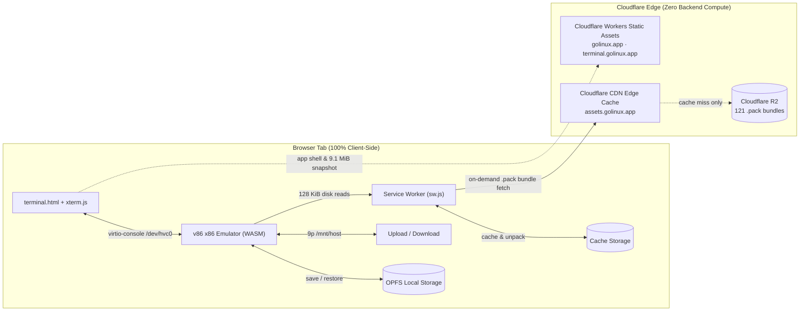

<div align="center">

# `>_` GoLinux

**An ultra-lightweight Alpine Linux 3.21 machine running 100% inside your browser.**  
Zero backend · WebAssembly x86 · Instant snapshot boot · Local OPFS persistence · Offline-ready

[Launch Terminal](https://terminal.golinux.app) · [Website](https://golinux.app) · [Architecture](#how-it-works) · [Local Dev](#quick-start)

-0D597F?style=flat-square&logo=alpinelinux&logoColor=white)


</div>

---

## About GoLinux

**GoLinux** boots a real 32-bit **Alpine Linux 3.21** system (Linux 6.12, `musl`, `BusyBox`, `bash`, `TinyCC`, `Python 3`, `git`, `nano`) directly inside your browser tab using [v86](https://github.com/copy/v86) (WebAssembly) and [xterm.js](https://xtermjs.org/).

There is **no server, no container, and no remote shell** — every CPU instruction executes locally on your device. Your files live privately in your browser's Origin Private File System (OPFS), survive reloads, and never leave your machine.

| Spec | Value |
| :--- | :--- |
| **Guest OS** | Alpine Linux 3.21 (`x86`) · Linux `6.12-virt` · `musl` · `BusyBox` |
| **Memory** | `128 MB` virtual RAM |
| **Instant Boot** | `~9.1 MiB` zstd-compressed VM snapshot (shell ready in `< 1s`) |
| **Virtual Disk** | `1 GiB` ext4 · `66 MB` compressed across `121` hybrid `.pack` bundles |
| **Networking** | Disabled by design (local offline-safe sandbox) |
| **Storage** | Automatic local OPFS persistence · `/mnt/host` 9p file transfer |

### Highlights

- **Instant Snapshot Boot** — Restores a pre-booted, pre-warmed Linux snapshot directly into RAM instead of waiting on a full kernel boot.
- **Fast on Mobile & Desktop** — Alpine + BusyBox + TinyCC (`tcc` via `gcc` wrapper) compiles and runs C programs in milliseconds, even on phones.
- **Mobile-First Terminal** — Fixed `visualViewport` layout, touch keybar (`Ctrl`/`Alt` one-shot latches unified with native keyboards), Android Gboard IME recovery, and zero-flicker resize handling.
- **Zero-Stdin Control (`INV-1`)** — Uses `virtio-console` (`/dev/hvc0`) for true out-of-band `SIGWINCH` resizing and 9p (`/mnt/host`) for file upload/download — nothing ever injects synthetic bytes into your shell.
- **Offline-Ready PWA** — Versioned Service Worker caches the app shell, snapshot, and demand-paged disk bundles for seamless offline use and clean automatic upgrades.

---

## How It Works



### Core Architecture

1. **Pre-Warmed Snapshot Boot**  
   Instead of cold-booting Linux on every visit, GoLinux ships a `~9.1 MiB` zstd-compressed v86 memory snapshot with the kernel, `bash`, and core binaries (`busybox`, `tcc`, `clear`, `lsblk`, `sl`, `cowsay`) already warm in page cache.

2. **Hybrid `.pack` Disk Bundling**  
   The `1 GiB` ext4 disk consists of `8,192` 128 KiB chunks (`6,972` empty, `1,220` with real data):
   - **Zeroed chunks** are synthesized locally in `sw.js` with **0 network requests**.
   - **Real chunks** are grouped by tool affinity (`core`, `tcc`, `git`, `python3`, `nano`, `man`, `curl`, etc.) into `121` compact `.pack` bundles (max `~765 KB`) indexed by `bundles.json`.
   - When the guest reads a chunk, `sw.js` fetches its `.pack` bundle once (deduplicated across concurrent reads) and unpacks all sibling chunks into Cache Storage in `< 1 ms`.

3. **Build-Versioned Immutable Assets**  
   Every image build receives a content-hashed `buildId` (`bundles/<buildId>/…`), allowing `Cache-Control: public, max-age=31536000, immutable` at Cloudflare's edge while keeping rollouts and rollbacks atomic. `sw.js` is byte-stamped on every deploy so returning tabs and Safari upgrade automatically without stale caches.

4. **Local Persistence Without Bloating Snapshots**  
   `save_state()` compresses your VM state to OPFS automatically on idle and tab hide. Files uploaded to `/mnt/host` live in v86's 9p share and are stripped from saved snapshots by `persist-9p.js`, keeping saved states lightweight.

5. **Native `virtio-console` Transport**  
   The terminal attaches directly to `/dev/hvc0` (`TERM=xterm-256color`) with out-of-band `virtio-console0-resize` events, full alternate-screen support (`nano`, `less`, `man`, `htop`, `vi`, `tmux`), and zero `stty` / `Ctrl-L` stdin hacks.

---

## Pre-Installed Tools

| Category | Tools |
| :--- | :--- |
| **Compilers & Dev** | `tcc` (with `gcc` wrapper), `python3` (3.12), `git`, `make`, `jq` |
| **Editors & Pagers** | `nano` (with syntax highlighting), `vi`, `less`, `man` (`mandoc` + POSIX & bash manuals) |
| **Shell & System** | `bash`, `BusyBox`, `tmux`, `htop`, `lsblk`, `tree`, `file`, `zip` / `unzip`, `curl` |
| **Fun** | `fastfetch` (native C), `cowsay`, `figlet`, `sl` |

---

## Project Structure

```text
├── index.html              Landing page (golinux.app)
├── terminal.html           Minimalist terminal app (terminal.golinux.app)
├── about.html              Credits and open-source licenses
├── landing.css / styles.css
├── worker.js               Multi-subdomain Cloudflare Worker router
├── wrangler.jsonc          Cloudflare Workers + Static Assets config
├── packs-config.js         Single source of truth for version, caches & URLs
├── sw.js                   Service Worker (precache, hybrid .pack unpacker, offline)
├── persist.js              OPFS autosave, restore & schema/buildId validation
├── persist-9p.js           Strips /mnt/host uploads out of saved VM snapshots
├── packs.js                Opt-in offline pack manager
├── js/                     Modular frontend (boot, terminal, keybar, transfer, status, fallback)
├── assets/                 Vendored v86 WASM, xterm.js, SeaBIOS, empty-chunk template
├── public/_headers         Cloudflare edge caching & security headers
└── tools/
    ├── image/              Docker Alpine builder, snapshot saver, pack & bundle builders
    ├── deploy/             Build stamper, R2 bundle uploader, deploy & live verifier
    ├── dev/                Local two-origin dev server
    └── test/               Unit, SW, pack, 9p, UI layout & Chrome E2E smoke tests
```

---

## Quick Start

### Run Locally

No build step or runtime npm dependencies required:

```sh
python3 -m http.server 8099
# Open http://localhost:8099/terminal.html
```

To mirror production's two-origin split (app origin + R2 asset origin):

```sh
python3 tools/dev/serve-two-origins.py --omit-empty-chunks
```

### Rebuild the Alpine Image & Bundles

Requires **Docker** (`linux/386` support), **Node 18+**, **Python 3**, and **zstd**:

```sh
bash tools/image/build.sh
node tools/image/save-state.js 128 images/debian-state.bin
zstd -19 -T0 -f images/debian-state.bin -o images/debian-state.bin.zst && rm -f images/debian-state.bin
node tools/image/build-id.js
node tools/image/build-tool-sets.js
rm -f packs/common.json
node tools/image/build-packs.js common
node tools/image/build-packs.js full
node tools/image/build-pack-index.js
node tools/image/build-bundles.js
node tools/image/verify-manifests.js
```

### Test & Deploy

```sh
# Automated test suites
node tools/test/unit.test.js
node tools/test/sw-chunk-fallback.test.js
node tools/test/packs.test.js
node tools/test/check-9p-state-shape.js
node tools/test/ui-layout.test.js

# Upload hybrid bundles to R2 and deploy (gated by full Chrome E2E smoke test)
node tools/deploy/upload-bundles-r2.js --concurrency 12
./tools/deploy/deploy-site.sh
```

See [DEPLOYMENT.md](./DEPLOYMENT.md) for full Cloudflare Workers & R2 setup details.

---

## Security Notes

- **Local-only sandbox** — Networking is disabled inside the guest; no code or files ever leave your browser.
- **Root credentials** — Guest login is `root:root` solely for normal single-user CLI ergonomics.
- **No tracking** — Zero analytics, cookies, or third-party telemetry.

---

## Credits & License

Powered by open-source software: [v86](https://github.com/copy/v86) (BSD-2-Clause), [xterm.js](https://xtermjs.org/) (MIT), [SeaBIOS](https://www.seabios.org/) (LGPL-3.0), [Alpine Linux](https://alpinelinux.org/), [BusyBox](https://busybox.net/) (GPL-2.0), and [TinyCC](https://bellard.org/tcc/) (LGPL-2.1). See [THIRD_PARTY.md](./THIRD_PARTY.md) for full license details.

GoLinux project code is licensed under the **[MIT License](./LICENSE)**.
