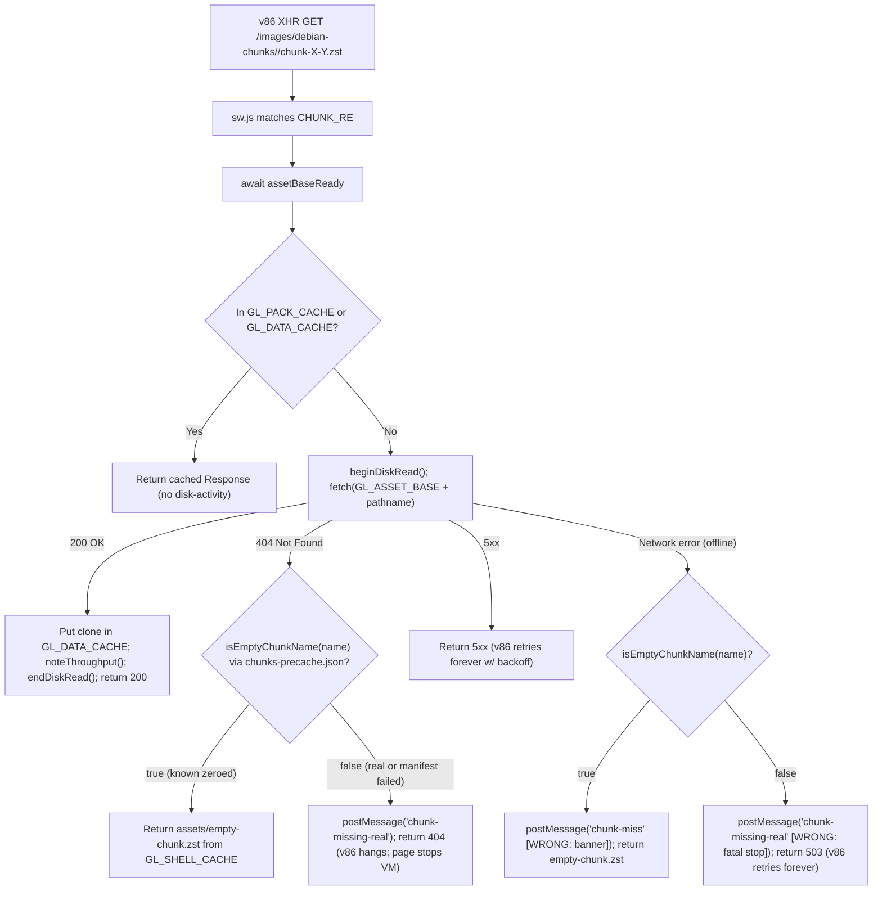

# GoLinux Architecture Audit

**Evidence tags used throughout `docs/stabilization/`:**
- **VERIFIED** — confirmed directly from source files, vendored `assets/v86/libv86.js`, git history, or local filesystem inspection.
- **INFERRED** — deduced from verified code combined with browser/platform specifications (not executed live in this audit).
- **GUESS** — hypothesis where live production state or untested browser behavior could not be observed directly.

---

## 1. Live vs. Local vs. Half-Finished State

Because this audit ran offline in a local sandbox without querying `https://golinux.app`, the exact bytes currently live on Cloudflare are **INFERRED** from `git log`, `HANDOFF.md`, and the owner's description; all local repository and staging facts are **VERIFIED**.

| Layer / Feature | Commit `5761126` ("Initial commit") | Commit `4e13103` (`HEAD`, local & `origin/main`) | Uncommitted working tree (also mirrored in `.deploy-pages/` as of Nov 23 15:25) | Live on `golinux.app` (**INFERRED**) |
|---|---|---|---|---|
| App shell, v86 boot, OPFS persistence (`persist.js`), 9p strip (`persist-9p.js`), Upload/Download | Present (**VERIFIED**) | Unchanged (`persist.js`, `persist-9p.js`) / modified (`index.html`) (**VERIFIED**) | Modified (`index.html` boot `serial0_send` + `watchShellPrompt`) (**VERIFIED**) | Older build (`5761126`-era) (**INFERRED**) |
| Service worker `CHUNK_RE` versioned build-id fix, `GL_CONFIG_CACHE` persistence, `chunks-precache.json` staging in `build-pages.sh` | **Missing** — flat `CHUNK_RE` only; `build-pages.sh` omitted `chunks-precache.json` (**VERIFIED**) | **Added** (**VERIFIED**) | Same as `4e13103` (**VERIFIED**) | Older build missing some/all of these unless hotfixed (**INFERRED**) |
| Offline packs rewrite (cache as truth, Web Lock, shared-aware removal) | Old `packs.js` (`localStorage` `GL_PACK_KEY`, no lock, shared-cache clobber) (**VERIFIED**) | Rewritten `packs.js` + dialog in `index.html` (**VERIFIED**) | Same as `4e13103` (**VERIFIED**) | Old `packs.js` (**INFERRED**) |
| Terminal full-viewport layout, overflow menu, 2-row keybar, `stty` resize | Fixed 80×24 `fitTerminal()`, single-row keybar (**VERIFIED**) | Rewritten layout, 2-row keybar, `stty` + `Ctrl-L` resize (**VERIFIED**) | Added `watchShellPrompt()` guard around `stty` (**VERIFIED**) | Old 80×24 layout (**INFERRED**) |
| Disk loading indicator, per-tool progress bar (`tools.json`), throughput probe & `maybePrefetch` | Not present (**VERIFIED**) | Added in `sw.js`, `packs-config.js`, `index.html`, `build-tool-sets.js` (**VERIFIED**) | Same as `4e13103` (**VERIFIED**) | Not live (**INFERRED**) |
| Cloudflare Worker deploy (`wrangler.jsonc`, `deploy-site.sh`) | Not present (**VERIFIED**) | Added (**VERIFIED**) | Same as `4e13103` (**VERIFIED**) | Worker `golinux` exists (**INFERRED** from `DEPLOYMENT.md:201`) |
| `TERM=xterm-256color` fix (`install.sh` + boot `serial0_send`) | `vt102` everywhere (**VERIFIED**) | `vt102` everywhere (**VERIFIED**) | **HALF-FINISHED** (**VERIFIED**): `install.sh` sets `xterm-256color` in `inittab` & `/etc/profile.d/term.sh`, but lines 82 & 89 STILL write `export TERM=vt102` to `/root/.bash_profile` and `/root/.bashrc`; `images/debian.img` and `debian-state.bin.zst` have NOT been rebuilt since Nov 22. | Not live (**INFERRED**) |
| Prompt-guarded `stty` resize (`watchShellPrompt` in `index.html`) | Not present (**VERIFIED**) | Unguarded `stty` injection (**VERIFIED**) | **HALF-FINISHED** (**VERIFIED**): still injects `stty`+`Ctrl-L` via `serial0_send`, false-positives on `#`/`$`, ignores keybar input, leaves duplicate `currentTerminal()` in `index.html:1602,1667`. | Not live (**INFERRED**) |

**Uncommitted working tree changes (`git status`, VERIFIED):**
- `index.html` (+66 lines): boot/cold-boot `export TERM=xterm-256color` injection; `watchShellPrompt()` + `shellAtPrompt`/`resizePendingGuest` guard.
- `tools/image/install.sh` (+13 lines): `getty ... xterm-256color` + `/etc/profile.d/term.sh` (contradicted by lines 82, 89).
- `tools/test/smoke-deploy.test.js` (+156 lines): TERM/SMCUP check, `nano` scrollback check, half-typed-command resize check.
- Local untracked/ignored `.deploy-pages/` (Nov 23 15:25) is byte-identical to the uncommitted working tree (`index.html`, `sw.js`, `packs.js` verified via `diff -q`).

---

## 2. System Topology & File Responsibilities

GoLinux is a static two-origin web application with no backend (**VERIFIED**):
- **App origin** (`https://golinux.app`, Cloudflare Worker `golinux` with Static Assets from `.deploy-pages`, `wrangler.jsonc`): serves HTML, JS, CSS, WASM, SeaBIOS, kernel (`debian-bzImage`, 5.5 MiB), initrd (`debian-initrd`, **24.18 MiB — within 860 KiB of the 25 MiB Worker file limit**, **VERIFIED**), snapshot (`debian-state.bin.zst`, 11.1 MiB), `images/build-id.json`, `chunks-precache.json`, `assets/empty-chunk.zst`, `_headers`.
- **Asset origin** (`https://assets.golinux.app`, Cloudflare R2 bucket `golinux-assets`): serves ~5,600 real zstd-compressed 128 KiB disk chunks under `images/debian-chunks/<buildId>/` (plus `empty-chunk.zst`) and pack JSON lists under `packs/<buildId>/` (`index.json`, `common.json`, `full.json`, `tools.json`). Zeroed chunks (35,358 of 40,960) are omitted and 404 on R2 (**VERIFIED** in `upload-r2.sh:75-86`).

### File-by-File Inventory (**VERIFIED**)

| File | Role / Responsibility | Notes |
|---|---|---|
| `packs-config.js` | Shared constants (`GL_VERSION`, `GL_ASSET_ORIGIN`, `GL_BUILD_ID`, cache names, URL helpers, prefetch thresholds). Loaded by both `index.html` (`<script>`) and `sw.js` (`importScripts`). | `GL_BUILD_ID` is `""` in source and stamped into `.deploy-pages/packs-config.js` at build time. |
| `sw.js` | Service worker: precaches `SHELL_FILES`, proxies chunk `GET`/`HEAD` requests from same-origin paths to `GL_ASSET_BASE`, caches chunks on demand in `GL_DATA_CACHE`, synthesizes zeroed chunks on 404 using `chunks-precache.json` + `assets/empty-chunk.zst`, caches snapshot, reports `disk-activity` and network `throughput` via `postMessage`. | Classic SW (`importScripts`). Also persists `?assets=` override in `golinux-config` cache. |
| `persist.js` | Browser OPFS persistence (`golinux/state.gz`, `golinux/meta.json`): tab ownership lock (`golinux-owner`), write lock (`golinux-state`), inline Blob Worker gzip compression, main-thread `DecompressionStream` gunzip, 30 s idle autosave + `visibilitychange`/`pagehide` saves, size limits (40 MB warn / 150 MB pause), build-id check on restore, `clearUserState()` for Reset. | Exposes `window.GoPersist`. |
| `persist-9p.js` | Wraps `emulator.save_state()` to temporarily clear `emulator.fs9p.inodedata` and non-`.`/`..` `direntries` so `/mnt/host` uploads are excluded from saved states without patching v86. | Exposes `window.Go9p`. Validates v86 internal shape once. |
| `packs.js` | Opt-in offline pack manager (`minimal`, `common`, `full`): reads `packs/<buildId>/*.json`, derives pack state from `GL_PACK_CACHE` keys, serializes jobs with Web Lock `golinux-pack-job`, downloads chunks (concurrency 6), removes non-protected chunks, broadcasts state on `BroadcastChannel("golinux-packs")`. | Exposes `window.GoPacks`. |
| `index.html` | 2,072-line monolith containing all CSS, HTML markup, and JS for: boot orchestration, SW readiness, snapshot download progress, offline packs dialog, offline banner, disk-activity + per-tool progress bar, `maybePrefetch`, persistence status + Reset, Upload/Download over 9p + `serial0_send`, terminal layout + `ResizeObserver` + `stty` resize, mobile key bar, toolbar overflow menu, fatal/loading overlays. | Primary complexity and regression magnet. |
| `about.html` | Static credits, Debian GPL source links, and license summary. | Clean, self-contained. |
| `manifest.json` | PWA manifest (`display: standalone`, icons). | Static. |
| `public/_headers` | Cloudflare static-asset HTTP header rules (copied to `.deploy-pages/_headers`). | Missing `! Cache-Control` detach directives (**VERIFIED**). |
| `public/r2-cors.json` | R2 bucket CORS policy (`GET`/`HEAD` for `https://golinux.app` + placeholder `YOUR-PROJECT.pages.dev`). | Applied via `wrangler r2 bucket cors set`. |
| `wrangler.jsonc` | Cloudflare Worker static-assets config (`name: "golinux"`, `assets.directory: ".deploy-pages"`). | Static. |
| `assets/v86/*`, `assets/xterm/*`, `assets/bios/*` | Vendored third-party binaries/libraries (`libv86.js`, `v86.wasm`, `v86-fallback.wasm`, `xterm.js`, `addon-fit.js` [unused], `xterm.css`, SeaBIOS/VGABIOS). | `addon-fit.js` is loaded & precached but unused. |
| `tools/image/*` | Offline image/artifact pipeline: `build.sh` + `install.sh` (Docker Debian i386 → ext4 → chunks), `build-chunk-manifest.js`, `build-id.js`, `build-snapshot.sh` + `save-state.js`, `build-packs.js`, `build-pack-index.js`, `build-tool-sets.js`, `verify-manifests.js`. | Generates gitignored `images/*`, `packs/*`, `chunks-precache.json`. |
| `tools/deploy/*` | `build-pages.sh` (stages `.deploy-pages`, stamps `GL_BUILD_ID`, runs `verify-manifests.js --deploy` & `smoke-deploy.test.js`), `deploy-site.sh` (runs build, confirms, `wrangler deploy`, live curl checks), `upload-r2.sh` (`aws s3 sync`/`cp` to R2), `stamp-build-id.sh` (mutates root `packs-config.js`). | `build-pages.sh` overrides `stamp-build-id.sh`. |
| `tools/dev/serve-two-origins.py` | Local two-origin dev server (ports 8090/8091). | `APP_PREFIXES` contains `""`, breaking isolation. |
| `tools/test/*` | `check-9p-state-shape.js`, `sw-chunk-fallback.test.js`, `packs.test.js`, `ui-layout.test.js`, `smoke-deploy.test.js`, `measure-tool-load.js`. | Headless Chrome / Node only; no Firefox/WebKit/upgrade/spy tests. |

---

## 3. Core Data Flows (**VERIFIED** against working tree)

### Flow 1: First Visit (Cold Browser Profile)

```mermaid
sequenceDiagram
  participant Page as index.html
  participant SW as sw.js
  participant App as golinux.app (Worker)
  participant R2 as assets.golinux.app (R2)
  participant V86 as v86 + xterm.js

  Page->>R2: loadToolSets() fetches packs/<buildId>/tools.json (before SW ready!)
  Page->>SW: navigator.serviceWorker.register("sw.js")
  SW->>App: install: precache SHELL_FILES -> GL_SHELL_CACHE, skipWaiting()
  SW->>Page: activate: delete old caches, clients.claim() -> controllerchange
  Page->>SW: postMessage({type:"set-asset-base", base: GL_ASSET_BASE})
  Page->>Page: GoPersist.claimOwnership() (Web Lock "golinux-owner")
  Page->>App: GoPersist.loadUserState() -> fetch images/build-id.json -> no OPFS state
  Page->>App: HEAD images/debian-state.bin.zst
  Page->>SW: GET images/debian-state.bin.zst (fetchSnapshotWithProgress)
  SW->>App: fetch snapshot -> caches in GL_DATA_CACHE
  Page->>Page: cacheSnapshot(buf) -> writes snapshot to GL_DATA_CACHE AGAIN
  Page->>V86: new V86({initial_state: {buffer}, hda: "/images/debian-chunks/<id>/chunk.zst", filesystem:{}})
  Page->>V86: Go9p.install(emulator)
  V86->>Page: emulator-loaded
  Page->>V86: serial0_send("export TERM=xterm-256color; clear; cat /etc/motd\n")
  Page->>V86: GoPersist.attach() + watchShellPrompt() + fitSoon() -> serial0_send(stty/Ctrl-L)
```

1. `packs-config.js` evaluates `GL_ASSET_BASE` (reads `?assets=` query param and persists to `localStorage` without host check; falls back to `GL_ASSET_ORIGIN`).
2. `loadToolSets()` fires immediately (`index.html:2061`) before SW control is established.
3. `prepareChunkAccess()` registers `sw.js` and waits up to 6 s for `navigator.serviceWorker.controller`. If remote chunks are configured and SW fails/times out, shows `#fatal` and aborts boot (`index.html:1372-1407`).
4. `bootMachine()` requests `navigator.storage.persist()`, claims `golinux-owner` Web Lock, calls `loadUserState()` (fetches `images/build-id.json`, finds no OPFS `golinux/state.gz`), HEAD-probes `images/debian-state.bin.zst`, streams it with progress, and writes it to `GL_DATA_CACHE` (redundant with `sw.js:472`).
5. `new V86(options)` restores `initial_state` (omitting `bzimage`/`initrd`), mounts `serial_console` into `#terminal`, and wraps `save_state` with `Go9p.install`.
6. On `emulator-loaded`, `index.html:1261` injects `export TERM=xterm-256color; clear; cat /etc/motd\n` via `serial0_send`, attaches `GoPersist`, starts `watchShellPrompt()`, and calls `fitSoon()` which triggers `applyGrid()` → `stty -echo` / `stty rows R cols C` / `stty echo` / `Ctrl-L`.

### Flow 2: Restore (Returning Visit with Saved User State)

1. SW already controls page; `index.html` and JS are served **cache-first** from `GL_SHELL_CACHE` (`sw.js:481-483`).
2. `bootMachine()` claims `golinux-owner` lock (second tab gets `owner = false` + warning banner).
3. `GoPersist.loadUserState()` (`persist.js:285-317`):
   - Fetches `images/build-id.json` (`sw.js:458-461` goes network-only, returning `{}` if offline → `buildId = null`).
   - Reads OPFS `golinux/meta.json` and checks `golinux/state.gz` exists.
   - Compares `buildId && meta.buildId && meta.buildId !== buildId`:
     - If both non-null and different: shows update warning, returns `null` (boots fresh shipped snapshot; old `state.gz` remains on disk until overwritten or Reset).
     - **Gap**: if either is `null` (e.g., offline), check is skipped and `state.gz` is restored anyway.
   - Reads `golinux/state.gz`, gunzips on main thread via `DecompressionStream("gzip")`, returns raw `ArrayBuffer`.
4. `new V86({ initial_state: { buffer: userState }, ... })` restores RAM, IDE write-back block cache, and empty 9p tree.
5. On `emulator-loaded`, `index.html:1260` **still sends** `export TERM=xterm-256color; clear; cat /etc/motd\n` into the restored session (wiping screen / injecting into any active program).

### Flow 3: Save (Autosave, Hide, Unload, Manual)

1. `GoPersist.attach()` (`persist.js:383-437`) only runs if `owner === true`.
2. Tracks `lastActivity` and `dirty = true` on `serial0-output-byte` and document `keydown`; polls `atPrompt` every 500 ms via `/[#$]\s*$/` on the last 400 bytes of serial output.
3. Triggers `saveNow(emulator, reason)`:
   - Every 30 s (`AUTOSAVE_MS`) if `Date.now() - lastActivity >= 2000`.
   - Every 5 s if `pendingSave && !saveInFlight && atPrompt && quiet >= 2s`.
   - Immediately on `visibilitychange` (`hidden`) and `pagehide`.
4. `saveNow()` (`persist.js:164-275`):
   - Rejects if `!owner`; sets `pendingSave = true` if `saveInFlight` or `!atPrompt` (causing lost saves on close if busy/in editor).
   - Calls `emulator.save_state()` (wrapped by `Go9p` to strip `fs9p.inodedata` and directory entries, restoring them in `finally`). Blocks main thread ~160 ms.
   - Transfers raw `ArrayBuffer` to inline Blob Worker for `CompressionStream("gzip")` (~600 ms).
   - If `gz.byteLength > 150 MB`, pauses autosave and returns.
   - Acquires Web Lock `golinux-state`: writes `golinux/state.gz.tmp`, calls `tmp.move("state.gz")`, then non-atomically writes `golinux/meta.json` (`{ buildId, savedAt, bytes, reason }`).
   - Sets `dirty = false` **after** async completion (wiping dirty flag for edits made during the save).

### Flow 4: Chunk Fetch (v86 Read → SW Proxy → R2 / Fallback)



1. v86 requests relative same-origin URLs (`/${GL_CHUNK_PATH}chunk-<start>-<end>.zst`) via XHR because v86's `Aa` constructor (`libv86.js:17210`) splits on the last dot and mangles hostnames in absolute URLs (**VERIFIED**).
2. `sw.js` normalizes cache key to `self.location.origin + url.pathname`, checks `GL_PACK_CACHE` then `GL_DATA_CACHE`, and on miss fetches from `GL_ASSET_BASE + url.pathname`.
3. `isEmptyChunkName()` fetches `chunks-precache.json` (`{ cache: "no-store" }`) on demand and caches the promise forever (including failures!). `chunks-precache.json` is NOT in `SHELL_FILES`.
4. `diskActivity` posts throttled (250 ms) `disk-activity` messages + an explicit `idle: true` after 250 ms quiet (`sw.js:221-248`), driving `#diskBar`, per-tool detection (`toolForNames`), and `maybePrefetch()`.

### Flow 5: Offline Pack Install / Remove / Use Minimal

1. User opens `#packs` dialog → `GoPacks.loadManifest()` fetches `packs/<buildId>/index.json` (intercepted and **cached in `GL_SHELL_CACHE`** by `sw.js:480-487` despite `{ cache: "no-store" }`, **VERIFIED**).
2. `GoPacks.packStates()` scans `GL_PACK_CACHE.keys()` and compares against `common.json` (701) and `full.json` (5,600).
3. `install(packId)` acquires Web Lock `golinux-pack-job`, spawns 6 concurrent workers fetching `glChunkUrl(name)` directly from R2 (bypassing SW `CHUNK_RE`? **No** — `sw.js:321` intercepts cross-origin `/debian-chunks/` too! So pack downloads ALSO pass through `sw.js`, which caches every chunk in `GL_DATA_CACHE` AND fires `disk-activity` + `maybePrefetch`, AND THEN `packs.js:207` stores a duplicate copy in `GL_PACK_CACHE`! **VERIFIED** in `sw.js:321,361,394` + `packs.js:202-209`!).
4. Every 20 chunks `packs.js` calls `emit()` → `packStates()` (full `cache.keys()` scan) + `BroadcastChannel("golinux-packs").postMessage({ type: "state" })` (which triggers an infinite ping-pong loop if 2 tabs are open!).
5. `removePack(packId)` / `useMinimal()` call `cancel()` synchronously (if running) and immediately call `withJob()` without awaiting cleanup → refused if a download was active. Otherwise `removePackChunks()` computes `protectedNames()` (complete other packs only) and deletes unprotected keys from `GL_PACK_CACHE`.

### Flow 6: App & Image Updates

1. **Code-only deploy** (`./tools/deploy/deploy-site.sh`, no `GL_VERSION` bump):
   - Browser checks `/sw.js` (subject to broken concatenated `Cache-Control` in `_headers`).
   - If `sw.js` bytes changed: new SW installs, fetches `SHELL_FILES` with `{ cache: "reload" }` into the **same** `GL_SHELL_CACHE` (overwriting files mid-session for open tabs), calls `skipWaiting()` + `clients.claim()`.
   - If `sw.js` bytes did **not** change (e.g. only `index.html` or `packs.js` changed): browser does **NOT** trigger SW `install`, and `sw.js:481` serves `GL_SHELL_CACHE` **cache-first**, so returning users stay pinned on the old `index.html`/JS **indefinitely**! (**VERIFIED**).
2. **Pack/tools re-record** (`DEPLOYMENT.md:233-242`):
   - Same `buildId` URL (`packs/<buildId>/*.json`). Must re-upload to R2 **and** bump `GL_VERSION` because `sw.js:480` caches `/packs/*` in `GL_SHELL_CACHE` and R2 sets `max-age=3600`.
3. **Full disk-image rebuild** (`build.sh` → `build-snapshot.sh` → `build-packs.js` → `upload-r2.sh` → `deploy-site.sh`):
   - New content-hash `buildId` minted under `images/debian-chunks/<newId>/` and `packs/<newId>/`.
   - `GL_BUILD_ID` stamped into `.deploy-pages/packs-config.js`; new `images/build-id.json` deployed.
   - Returning online user fetches new `build-id.json`, `persist.js:291` rejects old `state.gz` with a warning, and boots a fresh machine (user's unsaved-externally files in OPFS become inaccessible). Returning offline user gets `{}` for `build-id.json` (`buildId = null`), bypassing the check!

### Flow 7: Reset (and Restart)

- **Reset (`#resetBtn`, `index.html:1134-1144`)**:
  1. `confirm(...)` dialog.
  2. `await GoPersist.clearUserState()` removes OPFS directory `golinux` recursively **without** taking `golinux-state` lock and **without** disabling `GoPersist` unload handlers.
  3. `location.reload()` triggers `visibilitychange`/`pagehide` → `saveNow(emulator, "unload")` can fire right before navigation and race to recreate `golinux/state.gz`!
- **Restart (`#restart`, `index.html:1298`)**:
  1. Calls `window.emulator.restart()` → `v86.restart()` → `cpu.reboot_internal()` (`libv86.js:176090`).
  2. On snapshot boots, `bzimage`/`initrd` were never passed to `new V86(options)` and `debian.img` has no MBR bootloader → SeaBIOS cannot boot; VM hangs permanently (**VERIFIED**).

---

## 4. Duplicated Facts (Multiple Sources of Truth)

Every fact currently stored in more than one place (**VERIFIED**):

| Fact | Locations where it is stored | How they can disagree |
|---|---|---|
| **Build ID** | 1. `GL_BUILD_ID` stamped into `.deploy-pages/packs-config.js` (`packs-config.js:101`)<br>2. `images/build-id.json` fetched at runtime (`persist.js:34,102`)<br>3. `golinux/meta.json` in OPFS (`persist.js:234`)<br>4. Hardcoded `"3a3a2a8af275cc11"` in `tools/test/smoke-deploy.test.js:664,670,866,876` | Rollback via `stamp-build-id.sh` changes #1 but `build-pages.sh` overwrites it from #2; offline visit makes #2 return `null` while #1 still holds the stamped ID; #3 diverges on deploy; #4 breaks on next image rebuild. |
| **Asset Origin (`GL_ASSET_BASE`)** | 1. `GL_ASSET_ORIGIN` constant in `packs-config.js:21`<br>2. URL query `?assets=` (`packs-config.js:35`)<br>3. `localStorage["golinux.assets.override"]` (`packs-config.js:40`)<br>4. SW memory `GL_ASSET_BASE` (`packs-config.js:32,57`)<br>5. SW CacheStorage `golinux-config / asset-base-override` (`sw.js:54-64,114-120`) | Visiting `golinux.app/?assets=X` writes #3 and #5; on next visit without `?assets=`, page reads #1 (because #3 is localhost-guarded on read) while SW restores #5 (NOT host-guarded!). Page fetches packs from R2 while SW fetches chunks from `X`. Also #5 async restore races with incoming `set-asset-base` postMessage. |
| **Cache Version / Names** | 1. `GL_VERSION = "v13"` in `packs-config.js:13`<br>2. Hardcoded `"golinux-pack-v13"` / `"golinux-data-v13"` in `smoke-deploy.test.js:647,662,874`, `packs.test.js:19,329` | Bumping `GL_VERSION` breaks tests silently or tests wrong caches. |
| **Cached Disk Chunks** | 1. `GL_DATA_CACHE` (on-demand SW fetches **and** pack fetches intercepted by `sw.js:321,394`)<br>2. `GL_PACK_CACHE` (written by `packs.js:207`)<br>3. v86 in-RAM `block_cache` (`libv86.js:17218`) | Downloading a pack stores every chunk **twice** (both `GL_DATA_CACHE` and `GL_PACK_CACHE`, doubling browser storage usage!). Removing a pack only clears `GL_PACK_CACHE`, leaving copies in `GL_DATA_CACHE`. |
| **Installed Pack State** | 1. Derived from `GL_PACK_CACHE` keys (`packs.js:76-99`)<br>2. Unused constant `GL_PACK_KEY = "golinux.pack"` (`packs-config.js:134`) — live site (`5761126`) still reads/writes `localStorage` | Live-to-new upgrade leaves stale `localStorage["golinux.pack"]`; within new `packs.js`, `common ⊂ full` makes `common` appear "saved" whenever `full` is saved even after "Remove common". |
| **Guest `TERM` Value** | 1. `/etc/inittab` (`install.sh:60`: `xterm-256color`)<br>2. `/etc/profile.d/term.sh` (`install.sh:69`: `xterm-256color`)<br>3. `/root/.bash_profile` (`install.sh:82`: `vt102`)<br>4. `/root/.bashrc` (`install.sh:89`: `vt102`)<br>5. Boot-time `serial0_send("export TERM=xterm-256color...")` (`index.html:1262,1286`) | #3 and #4 overwrite #1 and #2 during image login; #5 hacks around #3/#4 by typing into the guest console. |
| **Shell Idle / Prompt State** | 1. `atPrompt` in `persist.js:42,403-406` (500 ms interval, 400-byte tail)<br>2. `shellAtPrompt` in `index.html:1643,1646-1665` (every byte, 600-byte tail, cleared on `keydown`) | Two independent heuristic prompt detectors with different windows and triggers; both false-positive on `#`/`$` in editors/output and miss keybar taps. |
| **Real Chunk Manifest** | 1. `images/debian-chunks/manifest.json` (used by `upload-r2.sh`, `build-id.js`, `build-packs.js`, `smoke-deploy.test.js`)<br>2. `chunks-precache.json` (used by `sw.js`, `build-pages.sh`, `deploy-site.sh`)<br>3. `packs/full.json` (5,600 real chunks) | Three separate JSON files representing the same 5,600 chunk set; `verify-manifests.js` does not verify `chunks-precache.json` matches `manifest.json`! |
| **BroadcastChannel for Packs** | 1. `"golinux-packs"` in `packs.js:31`<br>2. `"golinux-packs-ui"` in `index.html:637` | `index.html` listens on a channel nobody posts to; `packs.js` ping-pongs infinitely across tabs on `"golinux-packs"`. |
| **Disk Image Copies for Builders** | 1. `images/debian.img`<br>2. `/tmp/golinux-pack-recording.img` (`build-packs.js:81`)<br>3. `/tmp/golinux-tool-recording.img` (`build-tool-sets.js:101`)<br>4. `/tmp/golinux-tools-state.bin` (`build-tool-sets.js:73`) | #2, #3, #4 are never invalidated when #1 or `debian-state.bin.zst` are rebuilt! |
| **Memory Size** | 1. `MEMORY_SIZE = 256 * 1024 * 1024` in `index.html:408`<br>2. `MEM_MB="${MEM_MB:-256}"` in `build-snapshot.sh:18`<br>3. `MEMORY_SIZE = 256 * 1024 * 1024` in `build-tool-sets.js:36` | Changing one breaks snapshot restore (no automated check verifies agreement). |
